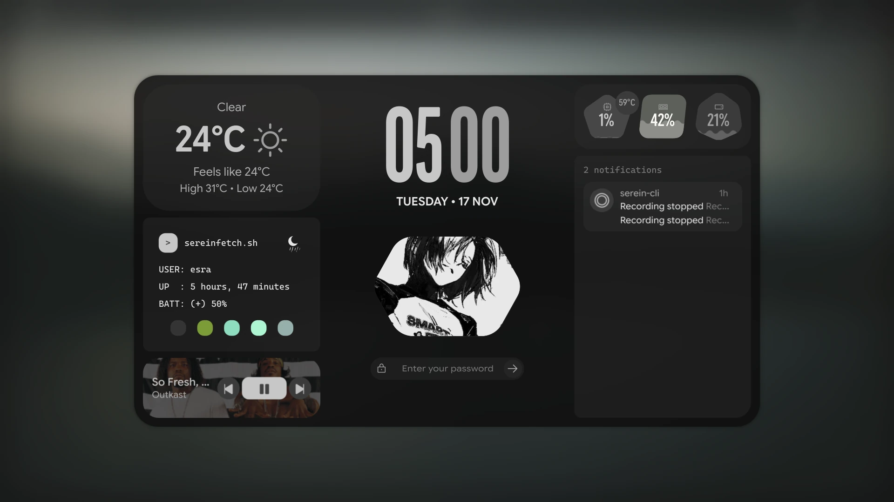

# Serein

A [Quickshell](https://quickshell.org) desktop shell for Hyprland, forked from
[Caelestia](https://github.com/caelestia-dots/shell) and rebranded around a crescent moon and fine rain
(*sérein*: rain falling from a clear evening sky).

Serein keeps Caelestia's shell (bar, dashboard, launcher, sidebar, notifications, lock screen, the Nexus
settings app) and adds its own identity and a few features on top.

> Serein is a fork and is **not affiliated with** the Caelestia project. All credit for the original shell
> goes to its authors; see [Credits and license](#credits-and-license).

## Preview



*The lock screen, with the falling rain and the compact media card.*

## What is different from Caelestia

- **Branding**: Serein name, logo (crescent moon and rain, drawn as vectors so it follows the theme colours),
  animated logo on the About page, and its own version number.
- **Bar on any edge**: left, right, top or bottom, switchable live from Nexus. The top/bottom bar is a
  separate horizontal layout (workspaces with window icons, clock, tray, status icons, active window).
- **Workspaces tab in the dashboard**: a grid of workspaces with live window previews (screencopy). Click a
  workspace to switch to it, click a window to focus it, or drag a window onto another workspace to move it.
- **Look**: a Serein colour scheme (night blue slate with an aqua-blue accent; `serein scheme set -n serein`) and a
  default wallpaper of a crescent moon and fine rain, both generated for this project.
- **Lock screen**: falling rain over the blurred background, and a Media card that switches to a compact row
  when the column is short.
- **Window info panel**: clicking the active window title in the bar opens the detached window info panel
  (preview, details, move-to-workspace buttons).
- **Nexus options** for the above: Panels → Taskbar → Position, Panels → Dashboard → Tabs → Workspaces,
  Panels → Lock screen.

## Requirements

- Hyprland (the Lua config API is used for some dispatchers; legacy dispatch strings are used as a fallback)
- `quickshell` (a recent build; `quickshell-git` is what Serein is developed against)
- [`serein-plugin`](https://github.com/esrahmn/serein-plugin): the native Qt/QML modules (`Serein.Config`,
  `Serein.Services`, `Serein.Blobs`, ...), a fork of Caelestia's plugin
- [`serein-cli`](https://github.com/esrahmn/serein-cli) (a fork of `caelestia-cli`): wallpapers, colour schemes,
  recording, the clipboard and emoji pickers, and a handle on the running shell (`serein shell ...`).
  Install it so `serein` is on your `PATH`; see its README
- The runtime dependencies of the plugin: `ddcutil`, `brightnessctl`, `libcava`, `networkmanager`, `lm_sensors`,
  `aubio`, `libpipewire`, `libqalculate`, `power-profiles-daemon`, `qt6-m3shapes`, and the Material Symbols,
  Rubik and Cascadia Code Nerd fonts

## Install

### Arch Linux (one package)

`packaging/arch/PKGBUILD` builds a single package, `serein-shell`, that contains the shell, `serein-plugin` and
`serein-cli` (all taken from the `v0.1.0` tags, so they stay in step):

```sh
git clone https://github.com/esrahmn/serein-shell
cd serein-shell/packaging/arch
makepkg -si
```

It installs the shell to `/etc/xdg/quickshell/serein`, the plugin to `/usr/lib/qt6/qml/Serein` and `serein` to
`/usr/bin`, so no `QML_IMPORT_PATH` is needed. Start the shell with `qs -c serein`. `serein-shell` depends on
`qt6-m3shapes-git` from the AUR (and conflicts with the unrelated AUR package `serein`, which ships the same
`/usr/bin/serein`).

#### Where things live

| What | Packaged install | Manual install |
| --- | --- | --- |
| Shell (QML) | `/etc/xdg/quickshell/serein` (system-wide, root-owned) | `~/.config/quickshell/serein` (yours to edit) |
| Plugin (`Serein.*`) | `/usr/lib/qt6/qml/Serein` | `~/.local/lib/qt6/qml/Serein` (+ `QML_IMPORT_PATH`) |
| CLI | `/usr/bin/serein` | wherever you linked it |
| Your settings and state | `~/.config/serein`, `~/.local/state/serein`, `~/.local/share/serein`, `~/.cache/serein` | same |

Quickshell looks for a config called `serein` in `~/.config/quickshell` first and only then in
`/etc/xdg/quickshell`, so **a copy in `~/.config/quickshell/serein` always wins over the packaged one**. To hack
on the QML, copy `/etc/xdg/quickshell/serein` (or clone this repository) there; to go back to the packaged
shell, rename or remove that folder. Package updates never touch your settings, which live in the user folders
above.

### By hand

1. Build and install the plugin (user-level, no root needed):

   ```sh
   git clone https://github.com/esrahmn/serein-plugin ~/src/serein-plugin
   cd ~/src/serein-plugin
   cmake -S . -B build -G Ninja -DCMAKE_BUILD_TYPE=Release -DVERSION=0.1.0 -DGIT_REVISION="$(git rev-parse HEAD)"
   cmake --build build
   cmake --install build --prefix ~/.local
   ```

   Qt must be told where it lives. In a Hyprland Lua config: `hl.env("QML_IMPORT_PATH", HOME .. "/.local/lib/qt6/qml")`
   (or export `QML_IMPORT_PATH=$HOME/.local/lib/qt6/qml` before starting `qs`). A system-wide install
   (`--prefix /usr`) needs no variable.

2. Install [`serein-cli`](https://github.com/esrahmn/serein-cli) so `serein` is on your `PATH`.

3. Get the shell and start it:

   ```sh
   git clone https://github.com/esrahmn/serein-shell ~/.config/quickshell/serein
   qs -c serein
   ```

   To start it with Hyprland, run `qs -c serein` from your autostart (for example
   `hl.exec_cmd("qs -c serein")` in a Lua config). Do not run it at the same time as the stock Caelestia shell:
   they would draw over each other.

### Coming from Caelestia

Serein reads and writes `~/.config/serein`, `~/.local/state/serein`, `~/.local/share/serein` and `~/.cache/serein`.
To bring your existing settings, colour scheme and wallpaper over, run once:

```sh
sh ~/.config/quickshell/serein/scripts/migrate-from-caelestia.sh
```

It only copies (never moves or deletes), so the Caelestia install keeps working.

## Development

See [docs/DEVELOPMENT.md](docs/DEVELOPMENT.md) for the three-repository layout, the dev loops (shell, plugin, CLI), how to
tell which copy is running, and how to release.

## Keybinds

Serein registers its global shortcuts under the `serein` app id (Caelestia's are under `caelestia`). Example
Hyprland Lua binds:

```lua
hl.bind("SUPER + I", hl.dsp.global("serein:nexus"),     { description = "Open Nexus settings" })
hl.bind("SUPER + J", hl.dsp.global("serein:sidebar"),   { description = "Toggle sidebar" })
hl.bind("CTRL + ALT + Delete", hl.dsp.global("serein:session"), { description = "Session menu" })
hl.bind("SUPER + SUPER_L", hl.dsp.exec_cmd("qs -c serein ipc call drawers toggle launcher"), { release = true })
```

Available shortcuts: `nexus`, `showall`, `dashboard`, `session`, `launcher`, `launcherInterrupt`, `sidebar`,
`utilities`, plus media, brightness and screenshot shortcuts. Run `qs -c serein ipc show` to list every IPC
target (`drawers`, `lock`, `nexus`, `notifs`, `mpris`, `audio`, `wallpaper`, ...).

## Configuration

| File | What it holds |
| --- | --- |
| `~/.config/serein/shell.json` | Shell settings read by the plugin (same format as Caelestia's `shell.json`) |
| `~/.local/state/serein/serein-ui.json` | Serein's own UI settings, which the plugin schema has no field for |

`serein-ui.json` keys (all editable from Nexus; the file is watched, so changes apply live):

| Key | Values | Default |
| --- | --- | --- |
| `barPosition` | `"left"`, `"right"`, `"top"`, `"bottom"` | `"left"` |
| `lockRain` | `true` / `false` | `true` |
| `dashboardOverview` | `true` / `false` | `true` |

## Notes

- Bar on the right: the sidebar, utilities, notifications and OSD stay on the right as well, next to the bar.
- Top/bottom bar: the dashboard (top) and launcher / utilities (bottom) open from the very edge of the screen
  instead of the whole bar.
- The horizontal workspace indicator does not draw special workspaces separately; it only dims.

## Credits and license

Serein is a modified version of **Caelestia** (<https://github.com/caelestia-dots/shell>), copyright its
authors, and it keeps Caelestia's license.

Serein is free software, released under the **GNU General Public License v3.0**; see [LICENSE](LICENSE). In
line with the GPL, the changes made on top of Caelestia are listed above and in the git history.
